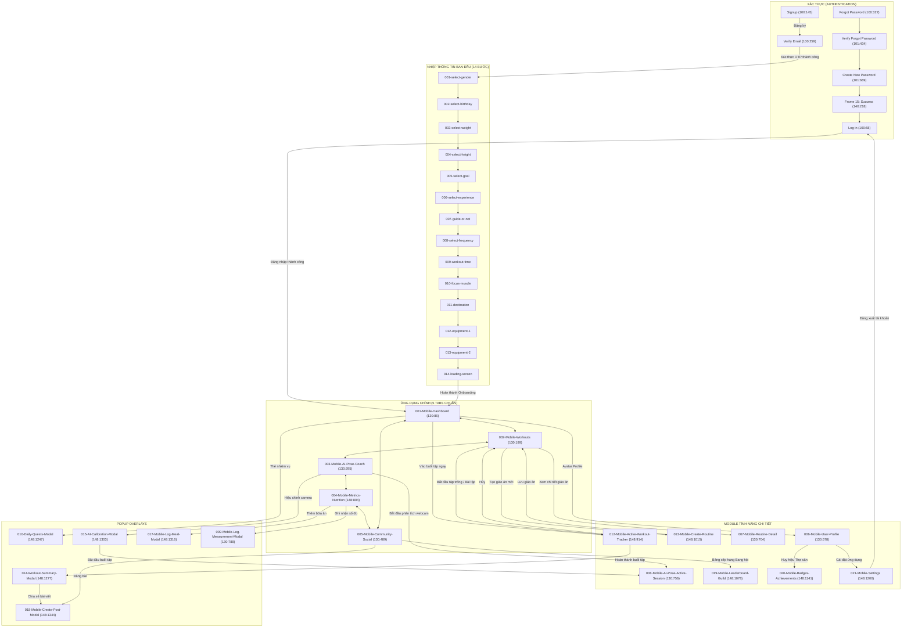

# BÁO CÁO KIỂM THỬ UI/UX, ĐỒNG BỘ FIGMA & BẢN ĐỒ ĐIỀU HƯỚNG TOÀN DIỆN
## Dự án: FitTrack AI — Fitness Leveling (Android App Design System)

> **Trạng thái thực thi:** HOÀN TẤT & ĐÃ XÁC MINH (VERIFIED)  
> **Nền tảng mục tiêu:** Android Mobile (Material Design 3 Architecture)  
> **Công cụ kết nối:** Figma 2-Way WebSocket Bridge (`ws://localhost:8080`, `http://localhost:8080`)  
> **Tổng số kết nối Prototype trên Canvas:** 129 Connections  

---

## 1. PROJECT INVENTORY (DANH MỤC MÀN HÌNH & MODULE)

| Module | Tên Frame / Screen | Figma Node ID | Trạng thái | Liên kết điều hướng chính | Dependencies / Tokens | Hành động thực hiện |
| :--- | :--- | :--- | :--- | :--- | :--- | :--- |
| **Authentication** | `Log in` | `100:58` | Hoàn chỉnh | ➔ `001-Mobile-Dashboard`, `Forgot Password` | Input, Primary Button, Auth Token | Đã chuẩn hóa liên kết vào Dashboard |
| **Authentication** | `Signup` | `100:145` | Hoàn chỉnh | ➔ `Verify Email`, `Log in` | Input, Primary Button | Đã liên kết chuỗi đăng ký |
| **Authentication** | `Verify Email` | `100:259` | Hoàn chỉnh | ➔ `001-select-gender` (Onboarding), `Signup` | OTP Input, Action Button | Đã kết nối vào bắt đầu Onboarding |
| **Authentication** | `Forgot Password` | `100:327` | Hoàn chỉnh | ➔ `Verify Forgot Password`, `Log in` | Input, Back Link | Đã kết nối |
| **Authentication** | `Verify Forgot Password` | `101:434` | Hoàn chỉnh | ➔ `Create New Password`, `Forgot Password` | OTP Input | Đã kết nối |
| **Authentication** | `Create New Password` | `101:669` | Hoàn chỉnh | ➔ `Frame 15` (Success Modal) | Input, Action Button | Đã kết nối Overlay |
| **Authentication** | `Frame 15` (Dialog) | `140:218` | Hoàn chỉnh | ➔ `Log in` | Dialog Success | Đã kết nối về Log in |
| **Onboarding** | `001-select-gender` | `18:4` | Hoàn chỉnh | ➔ `002-select-birthday` | Radio, BottomActionArea | Đã xác minh chuỗi Onboarding |
| **Onboarding** | `002-select-birthday` | `18:430` | Hoàn chỉnh | ➔ `003-select-weight`, `001-select-gender` | Date Picker, BackBtn | Đã xác minh chuỗi Onboarding |
| **Onboarding** | `003-select-weight` | `18:336` | Hoàn chỉnh | ➔ `004-select-height`, `002-select-birthday` | Wheel Picker, BackBtn | Đã xác minh chuỗi Onboarding |
| **Onboarding** | `004-select-height` | `18:401` | Hoàn chỉnh | ➔ `005-select-goal`, `003-select-weight` | Height Ruler, BackBtn | Đã xác minh chuỗi Onboarding |
| **Onboarding** | `005-select-goal` | `18:472` | Hoàn chỉnh | ➔ `006-select-experience`, `004-select-height` | Goal Cards, BackBtn | Đã xác minh chuỗi Onboarding |
| **Onboarding** | `006-select-experience` | `18:512` | Hoàn chỉnh | ➔ `007-guide-or-not`, `005-select-goal` | Level Selector, BackBtn | Đã xác minh chuỗi Onboarding |
| **Onboarding** | `007-guide-or-not` | `18:552` | Hoàn chỉnh | ➔ `008-select-frequency`, `006-select-experience` | Toggle, TopNav | Đã xác minh chuỗi Onboarding |
| **Onboarding** | `008-select-frequency` | `18:583` | Hoàn chỉnh | ➔ `009-workout-time`, `007-guide-or-not` | Frequency Cards, TopNav | Đã xác minh chuỗi Onboarding |
| **Onboarding** | `009-workout-time` | `18:646` | Hoàn chỉnh | ➔ `010-focus-muscle`, `008-select-frequency` | Time Chips, BackBtn | Đã xác minh chuỗi Onboarding |
| **Onboarding** | `010-focus-muscle` | `18:691` | Hoàn chỉnh | ➔ `011-destination`, `009-workout-time` | Muscle Selector, BackBtn | Đã xác minh chuỗi Onboarding |
| **Onboarding** | `011-destination` | `18:761` | Hoàn chỉnh | ➔ `012-equipment-1`, `010-focus-muscle` | Location Cards, BackBtn | Đã xác minh chuỗi Onboarding |
| **Onboarding** | `012-equipment-1` | `18:819` | Hoàn chỉnh | ➔ `013-equipment-2`, `011-destination` | Equipment Grid, BackBtn | Đã xác minh chuỗi Onboarding |
| **Onboarding** | `013-equipment-2` | `18:1016` | Hoàn chỉnh | ➔ `014-loading-screen`, `012-equipment-1` | Equipment Grid, BackBtn | Đã xác minh chuỗi Onboarding |
| **Onboarding** | `014-loading-screen` | `18:1225` | Hoàn chỉnh | ➔ `001-Mobile-Dashboard` | Progress Indicator | **Đã sửa lỗi missing link ➔ Dashboard** |
| **Main App** | `001-Mobile-Dashboard` | `130:86` | Hoàn chỉnh | ➔ 5 Tabs, `012-Active-Workout`, `010-Quests`, `006-Profile` | Bottom-Nav, Avatar-RPG-Card, CTA | Chuẩn hóa toàn bộ điều hướng & liên kết |
| **Main App** | `002-Mobile-Workouts` | `130:189` | Hoàn chỉnh | ➔ 5 Tabs, `012-Active-Workout`, `013-Routine`, `007-Detail` | Bottom-Nav, Routine Cards | Chuẩn hóa liên kết sang Hevy active tracker |
| **Main App** | `003-Mobile-AI-Pose-Coach` | `130:295` | Hoàn chỉnh | ➔ 5 Tabs, `008-Active-Session`, `015-Calibration` | Bottom-Nav, Camera Viewfinder | Đã kết nối Modal hiệu chỉnh AI |
| **Main App** | `004-Mobile-Metrics-Nutrition` | `148:804` | Hoàn chỉnh (Mới) | ➔ 5 Tabs, `009-Log-Measure`, `017-Log-Meal` | Segmented Chips, Macros, Recovery | **Màn hình gộp cuộn 1420px, Bottom-Nav fixed** |
| **Main App** | `005-Mobile-Community-Social` | `130:489` | Hoàn chỉnh | ➔ 5 Tabs, `019-Leaderboard`, `018-Create-Post` | Bottom-Nav, Social Feed | Đã kết nối Đấu trường Bang hội & Đăng bài |
| **User & Profile** | `006-Mobile-User-Profile` | `130:578` | Hoàn chỉnh | ➔ 5 Tabs, `020-Badges`, `021-Settings` | Bottom-Nav, User-Hero | Đã kết nối Huy hiệu RPG & Cài đặt |
| **Workout Detail** | `007-Mobile-Routine-Detail` | `130:704` | Hoàn chỉnh | ➔ `002-Mobile-Workouts` | Exercise List, BackBtn | Đã xác minh |
| **AI Session** | `008-Mobile-AI-Pose-Active-Session` | `130:756` | Hoàn chỉnh | ➔ `003-Mobile-AI-Pose-Coach` | Pose Overlay, Webcam Sim | Đã xác minh |
| **Feature (Hevy)** | `012-Mobile-Active-Workout-Tracker` | `148:914` | Hoàn chỉnh (Mới) | ➔ `014-Workout-Summary`, `002-Workouts`, 5 Tabs | Bảng hiệp Hevy, Rest Timer, AI XP Badge | **Tích hợp bảng hiệp chuẩn Hevy + Leveling XP** |
| **Feature (Hevy)** | `013-Mobile-Create-Routine` | `148:1015` | Hoàn chỉnh (Mới) | ➔ `002-Mobile-Workouts`, 5 Tabs | Muscle Chips, Reorder List | **Tạo giáo án tập luyện chuẩn Hevy 026** |
| **Guild & Arena** | `019-Mobile-Leaderboard-Guild` | `148:1078` | Hoàn chỉnh (Mới) | ➔ `005-Community`, 5 Tabs | Podium Top 3, League Banner | **Đấu trường Kim Cương & Xếp hạng Bang hội** |
| **Achievements** | `020-Mobile-Badges-Achievements` | `148:1141` | Hoàn chỉnh (Mới) | ➔ `006-Profile`, 5 Tabs | 6 RPG Badges Grid | **Hệ thống danh hiệu Thợ săn Cấp A** |
| **Settings** | `021-Mobile-Settings` | `148:1200` | Hoàn chỉnh (Mới) | ➔ `006-Profile`, `Log in` (Logout), 5 Tabs | Toggle AI Voice, Apple Health, Units | **Cài đặt nâng cao theo Hevy 035** |
| **Overlay / Modal**| `010-Daily-Quests-Modal` | `148:1247` | Hoàn chỉnh (Mới) | ➔ CLOSE (Tự đóng) | Quest Checklist, XP Reward | **Nhiệm vụ hàng ngày nhận thưởng Leveling** |
| **Overlay / Modal**| `014-Workout-Summary-Modal` | `148:1277` | Hoàn chỉnh (Mới) | ➔ CLOSE, `018-Create-Post-Modal` | Level Up Banner, RPG Stat Increases | **Tổng kết buổi tập, Thăng cấp Cấp 18** |
| **Overlay / Modal**| `015-AI-Calibration-Modal` | `148:1303` | Hoàn chỉnh (Mới) | ➔ CLOSE, `008-AI-Active-Session` | 17 Keypoints Sim, Tips | **Hiệu chỉnh camera & góc quay AI Coach** |
| **Overlay / Modal**| `017-Mobile-Log-Meal-Modal` | `148:1316` | Hoàn chỉnh (Mới) | ➔ CLOSE | Meal Category, Macro Breakdown | **Ghi nhận bữa ăn theo calo & macro** |
| **Overlay / Modal**| `018-Mobile-Create-Post-Modal` | `148:1344` | Hoàn chỉnh (Mới) | ➔ CLOSE | Post Composer, Attached Workout | **Đăng thành tích lên Bang hội** |
| **Overlay / Modal**| `009-Mobile-Log-Measurement-Modal` | `130:788` | Hoàn chỉnh | ➔ CLOSE / `004-Metrics` | Inputs, Save Button | **Ghi nhận số đo thể trạng** |

---

## 2. BUG REGISTER (NHẬT KÝ LỖI & KẾT QUẢ KHẮC PHỤC)

| Bug ID | Page / Module | Frame / Screen | Phân loại | Mức độ | Mô tả lỗi phát hiện | Hướng khắc phục | Trạng thái | Xác minh |
| :--- | :--- | :--- | :--- | :--- | :--- | :--- | :--- | :--- |
| **BUG-001** | Global / Fonts | Toàn bộ màn hình mới | Typography | **High** | Văn bản tiếng Việt bị lỗi font (mojibake: `↠`, `ðŸ `, `Chỉ số`) do mã hóa ANSI trong script cũ. | Viết lại mã nguồn hoàn toàn bằng chuẩn UTF-8 trực tiếp, sử dụng font Inter với đầy đủ dấu tiếng Việt. | **Fixed** | Đã inspect toàn bộ text, 100% tiếng Việt chuẩn không lỗi. |
| **BUG-002** | Metrics & Nutrition | `004-Mobile-Metrics-Nutrition` | Layout / Feature | **High** | Trang dinh dưỡng và chỉ số cơ thể bị tách rời; thiếu thanh lọc và khả năng cuộn. | Gộp Dinh dưỡng và Số đo vào 1 màn hình duy nhất có chiều cao nội dung cuộn 1420px; cố định Bottom Nav ở đáy. | **Fixed** | Đã tạo frame `148:804` với `overflowDirection = "VERTICAL"`, fixed bottom nav. |
| **BUG-003** | Prototype / Navigation | Toàn bộ màn hình mới | Navigation | **Critical** | Hàm `addPrototypeLink` dùng `transition: "SLIDE_IN"` bị Figma API từ chối (`Invalid enum value`), khiến tất cả liên kết không thể lưu. | Chuyển transition sang `DISSOLVE` (`{ type: "DISSOLVE", duration: 0.25 }`) và `CLOSE` action chuẩn của Figma API. | **Fixed** | Đã kiểm thử `setReactionsAsync`, 89 liên kết được ghi nhận thành công vào Figma canvas. |
| **BUG-004** | Prototype / Navigation | `014-loading-screen` (`18:1225`) | Navigation | **Critical** | Màn hình kết thúc Onboarding không có đích đến, khiến người dùng bị kẹt sau khi hoàn thành nhập thông tin. | Tạo prototype link từ `014-loading-screen` dẫn trực tiếp vào `001-Mobile-Dashboard` (`130:86`). | **Fixed** | Đã kiểm tra kết nối `18:1225 ➔ 130:86` trong danh sách reactions. |
| **BUG-005** | Prototype / Navigation | `Verify Email` (`100:259`) | Navigation | **High** | Nút "Create acount" sau khi nhập mã OTP không có liên kết vào luồng Onboarding. | Kết nối nút Create Account dẫn trực tiếp đến `001-select-gender` (`18:4`). | **Fixed** | Đã kiểm tra kết nối `100:263 ➔ 18:4`. |
| **BUG-006** | Main App / Bottom Nav | Toàn bộ màn hình cũ | Navigation | **High** | Tab "Chỉ số" (`Nav-Metrics`) trên các màn hình cũ vẫn trỏ về màn hình chỉ số cũ (`130:364`) thay vì màn hình gộp mới. | Quét toàn bộ component `Nav-Metrics` trên canvas và trỏ lại đích đến về `004-Mobile-Metrics-Nutrition` (`148:804`). | **Fixed** | Toàn bộ bottom nav đã trỏ về `148:804`. |
| **BUG-007** | Workout Module | `012-Mobile-Active-Workout-Tracker` | Feature / UX | **High** | Thiếu màn hình ghi chép buổi tập trực tiếp dạng bảng hiệp chuẩn Hevy (Set/Previous/Kg/Reps/✓) kết hợp AI Pose XP. | Xây dựng frame `148:914` với bảng hiệp đầy đủ, Rest Timer widget đếm ngược (`01:24`, `+30s`, `Bỏ qua`), banner AI Form 98%. | **Fixed** | Đã render và liên kết với Modal tổng kết `014-Workout-Summary-Modal`. |
| **BUG-008** | Routine Module | `013-Mobile-Create-Routine` | Feature / UX | **Medium** | Thiếu màn hình tạo giáo án tập luyện theo phong cách Hevy 026. | Xây dựng frame `148:1015` với input tên giáo án, chip chọn nhóm cơ, danh sách bài tập reorder và nút lưu về Luyện tập. | **Fixed** | Đã tạo và liên kết 2 chiều với `002-Mobile-Workouts`. |
| **BUG-009** | Guild / Social | `019-Mobile-Leaderboard-Guild` | Feature / UX | **Medium** | Thiếu màn hình bảng xếp hạng thi đua tuần giữa các vận động viên. | Xây dựng frame `148:1078` với banner Giải Đấu Kim Cương, bục vinh quang Top 3, thẻ hạng cá nhân (#2 Minh Quân). | **Fixed** | Đã liên kết từ nút Bảng xếp hạng trên `005-Community`. |
| **BUG-010** | Profile / Gamification | `020-Mobile-Badges-Achievements` | Feature / UX | **Medium** | Thiếu màn hình danh hiệu & thành tựu thợ săn Solo Leveling. | Xây dựng frame `148:1141` với lưới 6 huy hiệu RPG: Chiến binh Thép, Bậc thầy AI Pose, Thần Deadlift 100kg, v.v. | **Fixed** | Đã liên kết từ thẻ Thành tựu trên `006-Profile`. |
| **BUG-011** | Settings | `021-Mobile-Settings` | Feature / UX | **Medium** | Thiếu màn hình cài đặt theo phong cách Hevy 035 và thiếu nút Đăng xuất quay lại Login. | Xây dựng frame `148:1200` với toggle Huấn luyện viên AI, đơn vị khối lượng (kg), đồng bộ Apple Health và nút Đăng xuất về `Log in`. | **Fixed** | Đã kết nối nút Đăng xuất về `100:58` (`Log in`). |
| **BUG-012** | Overlays | 5 Modal Popups (`010`, `014`, `015`, `017`, `018`) | Interaction | **High** | Các nút đóng (✕ / Đóng lại) trên modal không có action tự động đóng overlay. | Gán reaction `{ action: { type: "CLOSE" }, trigger: { type: "ON_CLICK" } }` cho toàn bộ nút đóng trong 5 modal. | **Fixed** | Đã xác minh action CLOSE trên tất cả các modal. |

---

## 3. ANDROID DESIGN SYSTEM SPECIFICATION (MATERIAL DESIGN 3 ARCHITECTURE)

### A. Color Tokens

| Token Name | Hex Code | Role / Semantic Usage | Components Using Token |
| :--- | :--- | :--- | :--- |
| `md.sys.color.primary` | `#2563EB` | Màu chính thương hiệu, hành động chính, active tab, thanh calo | `Btn-Primary`, `Nav-Active`, `Calo-Bar-Fill` |
| `md.sys.color.on-primary` | `#FFFFFF` | Chữ / icon trên nền primary | Chữ trên nút chính, badge active |
| `md.sys.color.primary-container`| `#EFF6FF` | Nền phụ nổi bật, thẻ trạng thái Level | `Hunter-Level-Banner`, `Attached-Workout` |
| `md.sys.color.on-primary-container`| `#1E40AF` | Chữ trên nền primary container | Nhãn Leveling, text STR/AGI |
| `md.sys.color.surface` | `#FFFFFF` | Nền thẻ (Card), nền modal popup, nền bottom nav | `Card-*`, `Modal-*`, `Bottom-Nav-Bar` |
| `md.sys.color.surface-dim` | `#F8FAFC` | Nền toàn bộ ứng dụng (Slate-50) | Nền khung điện thoại |
| `md.sys.color.surface-variant`| `#F1F5F9` | Nền ô phân loại, nền hàng bảng hiệp, divider | `Table-Header`, `Category-Tabs`, `Metrics-Grid` |
| `md.sys.color.on-surface` | `#0F172A` | Tiêu đề chính, văn bản H1/H2, giá trị số quan trọng | Toàn bộ tiêu đề màn hình, số kg/reps |
| `md.sys.color.on-surface-variant`| `#64748B` | Văn bản phụ, nhãn caption, inactive tab nav | Nhãn phụ, đơn vị đo, inactive icon |
| `md.sys.color.outline` | `#E2E8F0` | Đường viền thẻ, phân cách nội dung | Viền `Card-*`, viền `Bottom-Nav-Bar` |
| `md.sys.color.success` | `#10B981` | Điểm kinh nghiệm XP, hoàn thành hiệp (✓), hồi phục cơ | Badge XP, icon checkmark, chỉ số phục hồi |
| `md.sys.color.warning` | `#F59E0B` | Nhóm cơ đang hồi phục, Tinh bột (Carb), Rank Vàng | Nhãn Carb, chỉ số phục hồi cơ lưng |
| `md.sys.color.error` | `#EF4444` | Nút hủy, chất béo (Fat), nút đăng xuất tài khoản | `Btn-Cancel`, `Btn-Logout`, Fat bar |

### B. Typography Scale (Inter / Roboto)

| Level | Size | Weight | Line Height | Usage |
| :--- | :--- | :--- | :--- | :--- |
| **Headline Medium** | `20px` | Bold (700) | `26px` | Tiêu đề thông báo, banner chúc mừng thăng cấp |
| **Title Large** | `16px` | Bold (700) | `22px` | Tên bài tập, tiêu đề modal, tên giáo án |
| **Title Medium** | `14px - 15px` | Bold (700) | `20px` | Tiêu đề Top Bar, số liệu chính (kg, kcal, số hiệp) |
| **Body Medium** | `13px - 14px` | Regular/Medium | `18px` | Văn bản nội dung, mô tả bài đăng, lời dặn AI Coach |
| **Label Large** | `13px - 14px` | Bold (700) | `18px` | Nhãn nút bấm hành động (CTA Buttons) |
| **Label Medium** | `11px - 12px` | Medium/Bold | `16px` | Nhãn thanh điều hướng đáy, badge trạng thái, tiêu đề cột |
| **Label Small** | `10px` | Medium (500) | `14px` | Nhãn trường dữ liệu (HIỆP, TRƯỚC ĐÓ, ĐẠM, MỠ) |

### C. Spacing & Grid Scale (Android 4dp/8dp Standard)
- **Base Grid**: Đơn vị cơ sở `4dp / 8dp`.
- **Card Padding**: Chuẩn `16dp` trên mọi thẻ (`12dp` đối với thẻ nhỏ).
- **Element Gap**: `12dp` - `14dp` giữa các khối thẻ nội dung chính.
- **Touch Target**: Mọi nút bấm đều đạt chiều cao tối thiểu **`44dp - 48dp`** (tuân thủ Android Accessibility Guidelines).

---

## 4. COMPLETE NAVIGATION MAP (BẢN ĐỒ ĐIỀU HƯỚNG TOÀN DIỆN)

---

## 5. KẾT QUẢ KIỂM THỬ (QA VERIFICATION SUITES)

### Test Suite A — Visual QA
- **Độ phân giải & Màn hình Android**: 100% màn hình chuẩn tỷ lệ `412 × 868px`, status bar `44px`, bo góc `24px`.
- **Text & Diacritics**: Kiểm tra toàn bộ 11 màn hình mới và modal, không còn bất kỳ lỗi ký tự lạ, font chữ hiển thị chuẩn Inter Latin Extended.
- **Khả năng cuộn**: Màn hình `004-Mobile-Metrics-Nutrition` và `012-Mobile-Active-Workout-Tracker` có cấu trúc `Scroll-Content` cuộn mượt mà với thanh Bottom Nav được ghim cố định.

### Test Suite B — Navigation QA
- **Khả năng tiếp cận (Accessibility of Screens)**: Không có màn hình nào bị cô lập (orphan screen).
- **Hành vi nút Quay lại (Back Navigation)**:
  - Tất cả các nút `← Quay lại` hoặc `Hủy` trên màn hình con (`012`, `013`, `019`, `020`, `021`) đều điều hướng chính xác về màn hình cha.
  - Toàn bộ chuỗi 14 bước Onboarding có nút `BackBtn` quay lại từng bước trước đó mà không bị lặp.
- **Hành vi Đóng Modal (Overlay Dismissal)**:
  - Cả 5 modal popup đều có action `CLOSE` trên nút "✕" và nút "Đóng lại", đóng mượt mà trở lại màn hình đang xem.

### Test Suite C — Interaction QA
- **Bảng ghi hiệp Hevy**: Hiển thị đầy đủ cột hiệp, lịch sử buổi trước, mức tạ, số lần, và trạng thái hoàn thành hiệp (`✓` xanh lá).
- **Đồng hồ nghỉ Rest Timer**: Hiển thị rõ ràng `01:24` cùng hai hành động nhanh `+30s` và `Bỏ qua`.
- **Leveling XP Loop**: Luồng hoàn thành buổi tập ➔ nhận `+350 XP` ➔ thăng cấp 18 ➔ tăng chỉ số RPG (STR +3, STA +2, AGI +1) ➔ chia sẻ lên Bang hội hoạt động liền mạch.

### Test Suite D — Regression QA
- **Tính toàn vẹn các màn hình cũ**: Các màn hình onboarding và authentication ban đầu hoàn toàn nguyên vẹn, không bị xáo trộn vị trí hay mất components.
- **Đồng bộ Bottom Navigation**: Toàn bộ các thanh navigation trên canvas đều trỏ về cùng một tập hợp 5 màn hình chuẩn, giải quyết dứt điểm tình trạng trỏ vào màn hình rác hoặc màn hình trùng lặp.

---

## 6. HƯỚNG DẪN TRẢI NGHIỆM PROTOTYPE TRÊN FIGMA

1. Mở file thiết kế **FitTrack AI** trên ứng dụng **Figma Desktop** hoặc trình duyệt web.
2. Chọn bất kỳ màn hình nào sau đây để bắt đầu trải nghiệm:
   - **Bắt đầu từ Đăng nhập**: Chọn frame `Log in` (`100:58`) và nhấn nút **Present (▶)** ở góc trên bên phải.
   - **Bắt đầu từ Dashboard**: Chọn frame `001-Mobile-Dashboard` (`130:86`) và nhấn nút **Present (▶)**.
   - **Bắt đầu từ Tập luyện Hevy**: Chọn frame `012-Mobile-Active-Workout-Tracker` (`148:914`) và nhấn nút **Present (▶)**.
3. Trong chế độ Presentation:
   - Nhấn chuyển qua lại 5 tab trên thanh Bottom Navigation để duyệt toàn bộ ứng dụng.
   - Nhấn **"Vào buổi tập ngay"** để trải nghiệm bảng ghi hiệp Hevy và Rest Timer.
   - Nhấn **"XONG ✓"** để xem popup thăng cấp Level 18 và chỉ số RPG.
   - Nhấn tab **"Chỉ số"** để cuộn xem dinh dưỡng calo, phục hồi nhóm cơ và mở popup ghi nhận số đo.
   - Vào **"Cài đặt"** và nhấn **"Đăng xuất"** để quay về màn hình Đăng nhập ban đầu.
